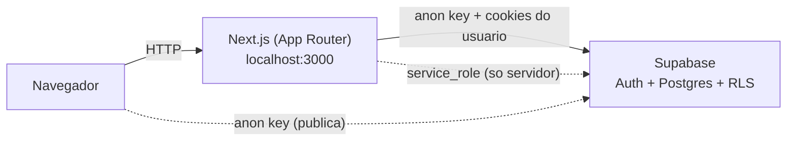
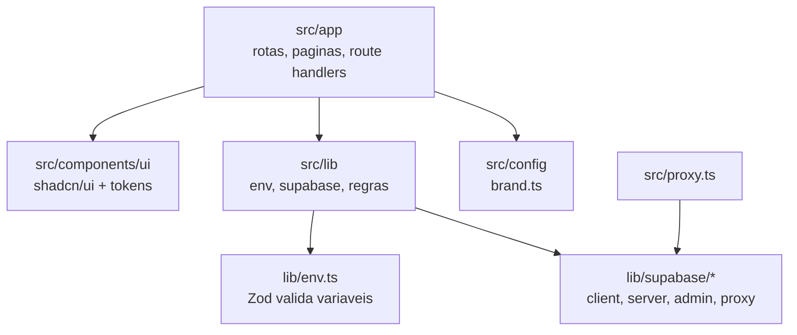
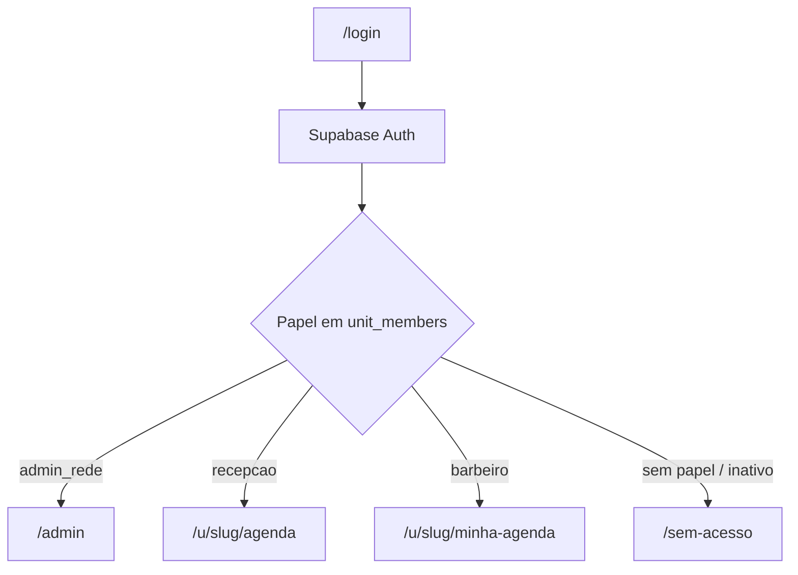

# Arquitetura

## Visão geral

Um único sistema e um único banco atendem todas as unidades. Cada unidade é um *tenant* isolado por **RLS (Row Level Security)** no Postgres, e não apenas pela API.

## Camadas e pastas

| Caminho | Responsabilidade |
|---|---|
| `src/app/` | Rotas (App Router). `api/health` já existe. |
| `src/components/ui/` | Componentes shadcn/ui, estilizados só por tokens. |
| `src/config/brand.ts` | Nome e logo da marca. |
| `src/lib/env.ts` | Validação das variáveis de ambiente com Zod. |
| `src/lib/supabase/client.ts` | Cliente do navegador (anon key). |
| `src/lib/supabase/server.ts` | Cliente de Server Components/Actions, com a sessão do usuário (RLS ativa). |
| `src/lib/supabase/admin.ts` | Cliente `service_role`. `server-only`: o build falha se importado no navegador. |
| `src/lib/supabase/proxy.ts` | Renova a sessão (cookies) a cada requisição. |
| `src/proxy.ts` | Ponto de entrada do proxy do Next 16 (antigo `middleware`). |
| `supabase/migrations/` | (Etapa 2) Migrations versionadas do banco. |

## Três clientes Supabase, três níveis de confiança

| Cliente | Chave | RLS | Onde pode rodar |
|---|---|---|---|
| `client.ts` | anon | Aplicada | Navegador |
| `server.ts` | anon + cookie do usuário | Aplicada | Servidor |
| `admin.ts` | service_role | **Ignorada** | Só servidor, operações administrativas |

Regra: o padrão é sempre `server.ts`. O `admin.ts` só é usado quando a operação realmente precisa passar por cima da RLS (ex.: convidar um usuário), e sempre depois de validar o papel do chamador no servidor.

## Observações do Next.js 16

- `middleware.ts` foi renomeado para **`proxy.ts`** (função `proxy`).
- O projeto usa **Cache Components** (`cacheComponents: true`): leituras dinâmicas (cookies, fetch ao vivo) ficam dentro de `<Suspense>` e/ou após `await connection()`. Não se usa `export const dynamic`.
- Antes de escrever código que dependa de APIs do Next, consultar `node_modules/next/dist/docs/` (ver `AGENTS.md`).

## Fluxo previsto (etapas seguintes)

