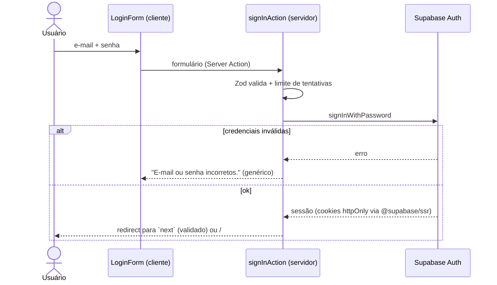
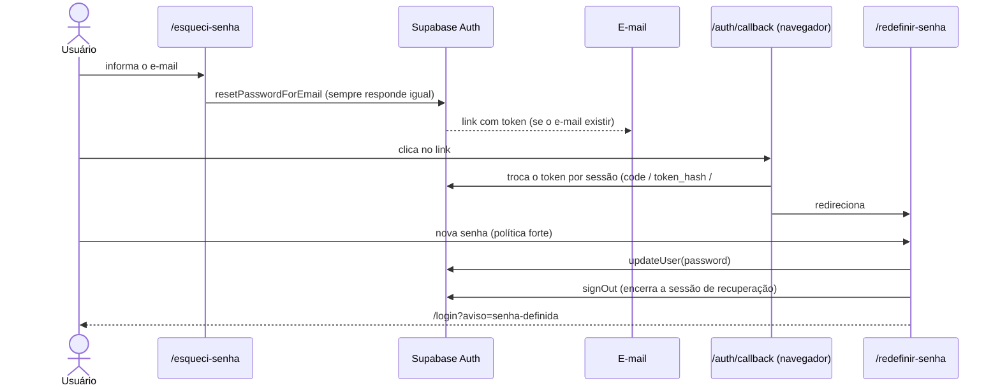

# Autenticação (login e recuperação de senha)

Telas: `/login`, `/esqueci-senha`, `/redefinir-senha` e o finalizador de links `/auth/callback`. Autenticação por **e-mail e senha** via Supabase Auth. Não há cadastro aberto: as contas são criadas pelo administrador (convite, Etapa 5).

## Rotas

| Rota | Função |
|---|---|
| `/login` | E-mail + senha. Quem já está logado é enviado para `/` |
| `/esqueci-senha` | Pede o link de recuperação por e-mail |
| `/auth/callback` | Recebe o link do e-mail, cria a sessão e segue para `?next=` |
| `/redefinir-senha` | Define a senha (recuperação **e** primeiro acesso por convite) |
| `/` | Provisória na Etapa 3 (sessão ativa + Sair). Na Etapa 4 vira o redirecionador por papel |

## Fluxo de login

## Fluxo de recuperação de senha

O `/auth/callback` roda no **navegador** porque links de convite e de alguns fluxos trazem os tokens no `#fragmento` da URL, que o servidor nunca recebe. Ele aceita os três formatos do Supabase (`?code=`, `?token_hash=&type=` e `#access_token=&refresh_token=`), limpa a URL antes de processar e, em qualquer falha, volta ao login com `?erro=link`.

## Medidas de segurança

| Medida | Onde |
|---|---|
| Mensagem de erro **genérica** no login (não revela se o e-mail existe) | `src/lib/auth/actions.ts` |
| Recuperação responde **sempre igual**, exista ou não o e-mail | idem |
| Limite de tentativas: login 5 por e-mail+IP e 30 por IP a cada 10 min; recuperação 3 por e-mail+IP e 10 por IP por hora | `src/lib/rate-limit.ts` |
| Senha forte (mín. 10, maiúscula, minúscula, número, símbolo, máx. 72) | `src/lib/validation/auth.ts` |
| Validação de toda entrada com Zod, no servidor | actions |
| `next` aceita só caminhos internos (anti *open redirect*) | `src/lib/safe-redirect.ts` |
| Sessão em cookies gerenciados por `@supabase/ssr`; validada com `getUser()` | `src/lib/supabase/*` |
| Sessão de recuperação é encerrada após definir a senha | `updatePasswordAction` |
| Tokens do link são removidos da barra de endereço antes de processar | `/auth/callback` |

### Limitações conhecidas

- O limitador é **em memória**: serve em `localhost` e numa instância só. Em produção (Vercel, várias instâncias) deve ser trocado por Redis/Upstash, mantendo a mesma assinatura. Além dele, o Supabase aplica seus próprios limites.
- **2FA opcional para o admin** (previsto no plano) não está nesta etapa.
- O e-mail padrão do Supabase tem limite baixo de envios por hora; para uso real configure um SMTP próprio no painel.

## Configuração necessária no painel do Supabase

*Authentication › URL Configuration*:

- **Site URL**: `http://localhost:3000`
- **Redirect URLs**: `http://localhost:3000/**`

Sem isso, o link de recuperação cai na raiz do site em vez de `/auth/callback`. (Em produção, adicione também o domínio final.)

## Como testar

1. `npm run db:seed` cria os usuários de teste (senhas em `.dev-credentials.local.md`, ignorado pelo Git).
2. `npm run dev` e abra <http://localhost:3000/login>.
3. Senha errada → erro genérico. Senha certa → "Login realizado" com o e-mail da conta; **Sair** volta ao login.
4. "Esqueci minha senha" → resposta igual para qualquer e-mail; o e-mail chega se a conta existir.
5. Link do e-mail → "Definir senha" → senha fraca é barrada → senha forte leva ao login com aviso verde.
