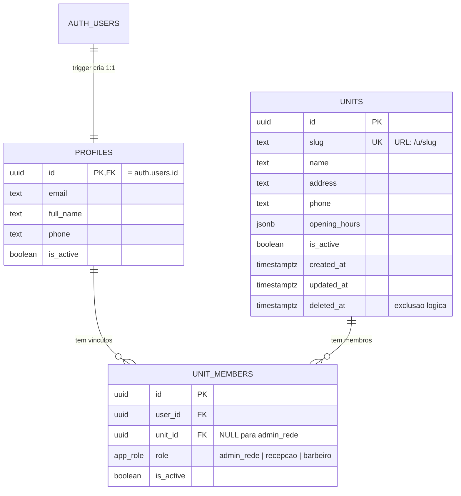

# Modelo de dados

Escopo da Etapa 2: rede, acesso e papéis. Cadastros, agenda e caixa entram nas fases seguintes.

## Dicionário

### `units`

| Coluna | Tipo | Regras |
|---|---|---|
| `id` | uuid | PK, gerado |
| `slug` | text | Único. Só `a-z`, `0-9` e `-`; 3 a 60 caracteres. Vai na URL (`/u/<slug>/...`) |
| `name` | text | 2 a 120 caracteres |
| `address`, `phone` | text | Opcionais |
| `opening_hours` | jsonb | Opcional; formato definido na Etapa 5 |
| `is_active` | boolean | `false` = unidade desativada: recepção e barbeiro perdem acesso |
| `deleted_at` | timestamptz | Exclusão lógica. Unidade excluída também bloqueia o acesso |

Não há `DELETE` para usuários: unidades são desativadas ou marcadas como excluídas.

### `profiles`

Uma linha por usuário do Supabase Auth, criada automaticamente por trigger (`on_auth_user_created`). O `email` é mantido em sincronia por outro trigger. `is_active = false` bloqueia o usuário em todas as unidades.

### `unit_members`

Liga um usuário a uma unidade com um papel.

- `admin_rede` **exige** `unit_id` nulo (vale para a rede toda).
- `recepcao` e `barbeiro` **exigem** `unit_id` preenchido.
- Um usuário pode ter papéis diferentes em unidades diferentes (ex.: barbeiro em duas lojas). O mesmo papel não se repete na mesma unidade (índice único).

Essas duas regras são garantidas por `CHECK` e índice no banco.

## Funções de autorização (SQL)

Todas `SECURITY DEFINER`, `search_path` vazio, baseadas em `auth.uid()`. Não são chamáveis por anônimos.

| Função | Retorna `true` quando |
|---|---|
| `is_network_admin()` | Usuário tem vínculo `admin_rede` ativo e perfil ativo |
| `has_unit_role(unit, roles[])` | Usuário tem um dos papéis na unidade, com vínculo, perfil e **unidade** ativos e não excluídos |
| `is_unit_member(unit)` | `has_unit_role` com `recepcao` ou `barbeiro` |
| `is_recepcao_of_user(alvo)` | Usuário é recepção ativa de uma unidade em que `alvo` também tem vínculo |

## Migrations

| Arquivo | Conteúdo |
|---|---|
| `20261014000100_base_units_profiles_members.sql` | Tipos, tabelas, triggers, funções e RLS |
| `20261014000200_seed_sao_bernardo_metropole.sql` | Cria a unidade `sao-bernardo-metropole` |
| `20261014000300_barbers.sql` | Tabela `barbers` (1 por barbeiro e unidade), RLS e privilégios por coluna |
| `20261014000400_barber_photos_storage.sql` | Bucket `barber-photos` e políticas do Storage |
| `20261014000500_barber_personal_data.sql` | Nome/sobrenome e endereço (CEP) |
| `20261014000600_barber_cnpj_phone.sql` | `cpf` vira `cnpj` (14 caracteres, aceita alfanumérico); telefone só com dígitos |
| `20261014000700_barber_job_title.sql` | Função do profissional (`job_title`), informativa |

Os arquivos seguem o padrão da Supabase CLI (`supabase/migrations/AAAAMMDDHHMMSS_nome.sql`).
