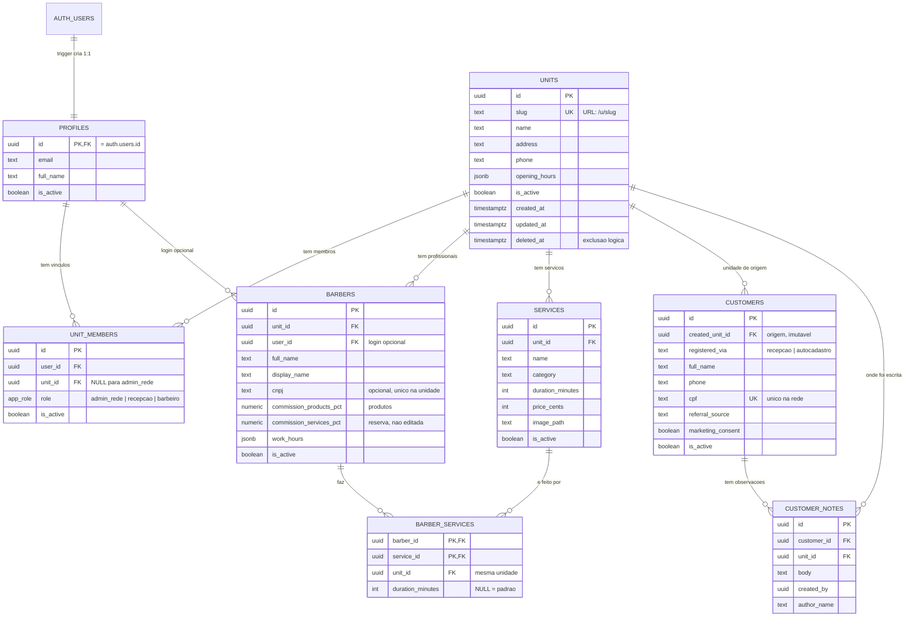

# Modelo de dados

Escopo atual: rede, acesso, cadastros (profissionais, serviços, produtos, pacotes, clientes) e a operação (agenda, comandas, caixa e comissões). O diagrama abaixo cobre a base; as tabelas da operação estão na seção seguinte.

## Dicionário

### `units`

| Coluna | Tipo | Regras |
|---|---|---|
| `id` | uuid | PK, gerado |
| `slug` | text | Único. Só `a-z`, `0-9` e `-`; 3 a 60 caracteres. Vai na URL (`/u/<slug>/...`) |
| `name` | text | 2 a 120 caracteres |
| `address`, `phone` | text | Opcionais |
| `opening_hours` | jsonb | Opcional; formato definido na Etapa 5 |
| `is_active` | boolean | `false` = unidade desativada: recepção e barbeiro perdem acesso |
| `deleted_at` | timestamptz | Exclusão lógica. Unidade excluída também bloqueia o acesso |

Não há `DELETE` para usuários: unidades são desativadas ou marcadas como excluídas.

### `profiles`

Uma linha por usuário do Supabase Auth, criada automaticamente por trigger (`on_auth_user_created`). O `email` é mantido em sincronia por outro trigger. `is_active = false` bloqueia o usuário em todas as unidades. Não há telefone neste perfil.

### `unit_members`

Liga um usuário a uma unidade com um papel.

- `admin_rede` **exige** `unit_id` nulo (vale para a rede toda).
- `recepcao` e `barbeiro` **exigem** `unit_id` preenchido.
- Um usuário pode ter papéis diferentes em unidades diferentes (ex.: barbeiro em duas lojas). O mesmo papel não se repete na mesma unidade (índice único).

Essas duas regras são garantidas por `CHECK` e índice no banco.

### `barbers`

Um registro por profissional **e unidade** (o mesmo barbeiro em duas lojas tem duas linhas). `user_id` é opcional: liga o profissional ao login (papel `barbeiro`). Principais regras:

- Nome completo (2 a 120) e nome de exibição (2 a 40); sobrenome, endereço e CEP opcionais; telefone só com dígitos; CNPJ opcional (14 caracteres, aceita alfanumérico), único na unidade; `job_title` informativo.
- `commission_products_pct`: 0 a 100, editado na aba Comissões. `commission_services_pct` não aparece no cadastro: a comissão de serviços vem da tabela `commission_brackets`. A coluna só entra se essa tabela estiver vazia.
- `work_hours`: expediente por dia da semana (jsonb), com intervalo de almoço opcional, sempre dentro do horário da unidade.
- `photo_path` precisa começar com a pasta da unidade (`<unit_id>/...`).
- `UPDATE` só nas colunas listadas na migration (privilégio por coluna); não há `DELETE`: o profissional é desativado.

Detalhes em [profissionais.md](profissionais.md).

### `services`

Catálogo **por unidade**. Preço em **centavos** (0 a R$ 100.000,00), duração de 5 a 480 minutos, categoria (`cabelo`, `barba`, `combo`, `sobrancelha`, `tratamento`, `outros`), `image_path` opcional. Sem `DELETE`: serviço é desativado. Detalhes em [servicos.md](servicos.md).

### `barber_services`

Quem faz cada serviço. A **mesma unidade** é garantida por chave estrangeira composta `(barber_id, unit_id)` e `(service_id, unit_id)`: não existe ligação entre unidades. `duration_minutes` é a duração própria do profissional naquele serviço (`NULL` = usa a do catálogo).

### `customers`

Cliente **da rede** (não de uma unidade). Principais regras:

- `created_unit_id` (unidade de origem) e `registered_via` (`recepcao` ou `autocadastro`) são gravados na criação e **imutáveis**.
- Só nome (2 a 120) e telefone (DDD + 8 ou 9 dígitos, só dígitos) são obrigatórios. Telefone e CPF são **únicos na rede** (índices parciais; telefone só quando preenchido).
- `search_name`: coluna gerada (minúsculas e sem acento) usada na busca da lista.
- `referral_source`: como conheceu (`indicacao`, `instagram`, `facebook`, `google`, `passou_em_frente`, `outro`).
- `marketing_consent` e `consent_at`: consentimento de comunicação (LGPD).
- `photo_path`: `<uuid>.(webp|jpg|png)`, sem pastas.
- Sem `DELETE`: o cliente é desativado (`is_active`). A coluna `preferred_barber_id` foi removida (não havia tela). `profiles.phone` também: o telefone fica no profissional, no cliente ou na unidade.

Detalhes em [clientes.md](clientes.md).

### `customer_notes`

Observações da recepção sobre o cliente (várias por cliente). `body` de 1 a 1000 caracteres. `created_by` e `author_name` são preenchidos por gatilho a partir da sessão (não são enviados pelo cliente); `unit_id` é a unidade onde foi escrita (vira `NULL` se a unidade for removida); excluir o cliente apaga as observações em cascata. Só `body` pode ser editado.

## Operação (agenda, caixa, pacotes, comissões)

Todas filtradas por `unit_id`, exceto a tabela de comissão, que é da rede. Dinheiro sempre em centavos. Não há exclusão física de comanda nem de caixa: cancelam ou fecham.

| Tabela | Para que serve |
|---|---|
| `appointments`, `appointment_services` | Agenda. Um agendamento pode ter serviços e filhos (encaixe). A recepção pode encaixar. O booking público do cliente ainda não existe; quando existir, `appointmentSlotTaken` (`src/lib/agenda/conflicts.ts`) barra horário ocupado antes de gravar |
| `products` | Catálogo de produtos da unidade |
| `packages`, `package_items` | Modelo de pacote (serviços + desconto % + validade) |
| `customer_packages`, `customer_package_items` | Pacote vendido ao cliente (foto da venda). Ativa ao cobrar a comanda; o saldo é o que sobra dos itens, não um contador |
| `cash_registers`, `cash_movements`, `cash_register_events` | Um caixa por dia. Sangria não passa do dinheiro da gaveta. O fechamento só exige comandas abertas **daquele dia** |
| `tickets`, `ticket_items`, `ticket_payments`, `ticket_tips` | Comanda. Serviço exige profissional (senão a comissão se perde). A venda do pacote não tem profissional; o uso de cada serviço tem. A comanda só fecha no caixa do dia em que foi aberta |
| `commission_brackets` | Faixas da comissão de serviços (admin da rede). O % da faixa do faturamento mensal de serviços vale sobre o mês inteiro. Produtos usam o % do profissional |

Funções principais dessa parte: `save_appointment`, `open_ticket_from_appointment`, `save_open_ticket`, `charge_ticket`, `replace_ticket_items`, `close_cash_register`, `reopen_cash_register`, `reopen_ticket`, `commission_summary`.

## Funções de autorização (SQL)

Todas `SECURITY DEFINER`, `search_path` vazio, baseadas em `auth.uid()`. Não são chamáveis por anônimos.

| Função | Retorna `true` quando |
|---|---|
| `is_network_admin()` | Usuário tem vínculo `admin_rede` ativo e perfil ativo |
| `has_unit_role(unit, roles[])` | Usuário tem um dos papéis na unidade, com vínculo, perfil e **unidade** ativos e não excluídos |
| `is_unit_member(unit)` | `has_unit_role` com `recepcao` ou `barbeiro` |
| `is_recepcao_of_user(alvo)` | Usuário é recepção ativa de uma unidade em que `alvo` também tem vínculo |
| `is_any_reception()` | Usuário é recepção ativa de **qualquer** unidade ativa (usada nos clientes, que são da rede) |

Outras funções do banco:

| Função | Para que serve |
|---|---|
| `network_units()` | Lista `id`, nome e slug das unidades não excluídas, só para admin e recepção. A recepção não lê `units` de outras lojas, mas precisa mostrar a unidade de origem do cliente e da observação |
| `customer_photo_name_ok(nome)` | Confere se o nome do arquivo da foto do cliente é `<uuid>.(webp\|jpg\|png)`; usada nas políticas do bucket |
| `customer_notes_set_author()` | Gatilho `BEFORE INSERT` das observações: grava autor (`auth.uid()` + perfil) e ignora o que o cliente enviar |
| `set_updated_at()` | Gatilho que atualiza `updated_at` |

## Migrations

| Arquivo | Conteúdo |
|---|---|
| `20261014000100_base_units_profiles_members.sql` | Tipos, tabelas, triggers, funções e RLS |
| `20261014000200_seed_sao_bernardo_metropole.sql` | Cria a unidade `sao-bernardo-metropole` |
| `20261014000300_barbers.sql` | Tabela `barbers` (1 por barbeiro e unidade), RLS e privilégios por coluna |
| `20261014000400_barber_photos_storage.sql` | Bucket `barber-photos` e políticas do Storage |
| `20261014000500_barber_personal_data.sql` | Nome/sobrenome e endereço (CEP) |
| `20261014000600_barber_cnpj_phone.sql` | `cpf` vira `cnpj` (14 caracteres, aceita alfanumérico); telefone só com dígitos |
| `20261014000700_barber_job_title.sql` | Função do profissional (`job_title`), informativa |
| `20261014000800_services.sql` | Tabela `services` (preço em centavos, duração, categoria), RLS e privilégios por coluna |
| `20261014000900_service_categories.sql` | Nova lista de categorias (tratamento vira química, outros vira cabelo) |
| `20261014001000_service_categories_extra.sql` | Volta `tratamento` e `outros` à lista |
| `20261014001100_service_images.sql` | `services.image_path`, bucket `service-images` e políticas do Storage |
| `20261014001200_barber_services.sql` | Tabela de ligação profissional x serviço (mesma unidade garantida por chave composta) |
| `20261014001300_barber_service_duration.sql` | Duração própria do profissional em cada serviço (`NULL` = padrão) |
| `20261014001400_customers.sql` | Funções `is_any_reception` e `network_units`, tabela `customers`, RLS e bucket `customer-photos` |
| `20261014001500_customer_notes.sql` | Tabela `customer_notes` com gatilho de autoria e RLS; migra e remove `customers.notes` |
| `20261014001600` em diante | Configuração da unidade, agenda, caixa, produtos, pacotes, comissões e as correções posteriores (telefone único, sangria, comissão progressiva, colunas sem uso). A lista completa é a pasta `supabase/migrations/` |

Os arquivos seguem o padrão da Supabase CLI (`supabase/migrations/AAAAMMDDHHMMSS_nome.sql`). Aplicação: `npm run db:migrate`.
