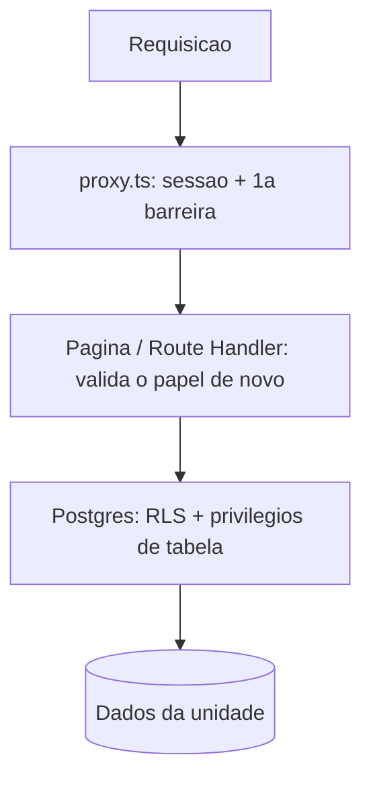

# Matriz de permissões e RLS

O isolamento entre unidades é feito **no banco** (RLS). Se a aplicação tiver um bug, o Postgres ainda barra o acesso indevido. A `service_role` ignora a RLS e só é usada no servidor.

## Quem pode o quê

Legenda: **R** ler · **C** criar · **U** atualizar · **D** apagar · **—** nada

| Tabela | Anônimo | Sem papel | Barbeiro | Recepção | Admin da rede |
|---|---|---|---|---|---|
| `units` | — | — | R (só a sua) | R (só a sua) | R, C, U (todas) |
| `profiles` | — | R, U\* (o próprio) | R, U\* (o próprio) | R (o próprio e quem é da sua unidade), U\* (o próprio) | R (todos), U\* (o próprio) |
| `unit_members` | — | R (o próprio) | R (o próprio) | R (os da sua unidade) | R, C, U, D (todos) |
| `barbers` | — | — | R (só o próprio registro) | R, U (da sua unidade)\*\* | R, U (todos)\*\* |
| `services` | — | — | R (da sua unidade) | R, C, U (da sua unidade) | R, C, U (todas) |
| `barber_services` | — | — | R (da sua unidade) | R, C, D (da sua unidade) | R, C, D (todas) |
| `customers` | — | — | — | R, U (**todos da rede**), C (origem = própria unidade)\*\*\* | R, C, U (todos) |
| `customer_notes` | — | — | — | R, U, D (todas), C (com a própria unidade)\*\*\*\* | R, C, U, D (todas) |

\* `profiles`: o usuário só altera `full_name` e `phone`. `email` e `is_active` não são editáveis por ele (privilégio de coluna). `is_active` muda só pelo servidor.

\*\* `barbers`: criar o profissional exige a `service_role` (conta de acesso), então o `INSERT` é só do servidor, depois do guard da unidade. Não há `DELETE`: o profissional é desativado. `UPDATE` só nas colunas liberadas.

\*\*\* `customers`: o cliente é **da rede**, então a recepção de qualquer unidade lê e edita todos. `created_unit_id`, `registered_via` e `created_at` não têm `UPDATE`. Não há `DELETE`: desativa-se.

\*\*\*\* `customer_notes`: só `body` é editável; `created_by` e `author_name` vêm de gatilho (sessão), nunca do cliente.

### Storage (fotos)

| Bucket | Leitura | Escrita (envio, troca, remoção) | Nome do arquivo |
|---|---|---|---|
| `barber-photos` | pública (URL) | admin e recepção da unidade | `<unit_id>/<barber_id>.<ext>` |
| `service-images` | pública (URL) | admin e recepção da unidade | `<unit_id>/<service_id>.<ext>` |
| `customer-photos` | pública (URL) | admin e recepção de qualquer unidade | `<customer_id>.<ext>` (sem pastas) |

Todos limitam o tamanho do arquivo e aceitam só `webp`, `jpeg` e `png`. Os nomes são UUIDs (não dá para adivinhar a URL); a listagem do bucket não é pública.

Observações:

- "A sua unidade" só vale enquanto **vínculo, perfil e unidade estão ativos** e a unidade não foi excluída. Desativar uma unidade tira o acesso da recepção e dos barbeiros dela imediatamente, inclusive aos clientes.
- Recepção altera as **configurações** da própria unidade (nome, CNPJ, endereço, telefones, horário, agenda, logo e capa), mas **não** o slug, a situação (ativa/inativa) nem a exclusão: isso é só do admin da rede (gatilho no banco).
- **Privacidade dos clientes:** por decisão do negócio, a recepção de qualquer unidade vê todos os clientes da rede e suas observações. O barbeiro não lê a tabela (a agenda mostrará só o necessário, por consulta específica).
- Criar usuários e vínculos é função do admin da rede (painel) e da recepção para barbeiros da própria unidade. Na prática, passam pelo servidor com `service_role`, **depois** de validar o papel de quem pediu.

## Defesa em camadas

1. **Privilégios de tabela**: `anon` não tem acesso algum às tabelas; `authenticated` só o necessário, **por coluna** nos cadastros.
2. **RLS** ligada em todas as tabelas, com policies por papel e unidade.
3. **Funções** de autorização `SECURITY DEFINER` (sem recursão de policy, sem acesso por anônimos).
4. **Aplicação**: valida o papel no servidor antes de renderizar ou executar ações; a unidade vem do guard, nunca do formulário.

## Como testamos

| Comando | O que cobre | Precisa de |
|---|---|---|
| `npm test` | Regras puras com Vitest: papéis, validações (unidade, profissional, serviço, cliente), vínculos, menu da unidade | Nada |
| `npm run test:rls:offline` | Roda **todas** as migrations num Postgres embutido (PGlite) e confere 229 cenários: anônimo, recepção A e B, barbeiro, sem papel, admin, unidade desativada, escalada de privilégio, `is_active`, cadastros (profissionais, serviços, clientes, observações) e Storage | Nada (offline) |
| `npm run test:rls` | Os cenários de acesso **no Supabase real**, com usuários temporários logados via anon key (159). Limpa tudo no fim | Migrations aplicadas + `.env.local` |
| `npm run test:access` | Redirecionamentos e bloqueios por papel, unidade, unidade desativada e perfil inativo (41 cenários) | App rodando + `.env.local` |
| `npm run test:e2e` | Navegador real em Profissionais e Serviços (telas, fotos, validações, vínculos) | App rodando + `.env.local` |
| `npm run test:e2e:clientes` | Navegador real em Clientes (77 verificações: cadastro, busca, observações, histórico, outra unidade, celular) | App rodando + `.env.local` |

Os testes que usam o Supabase real criam usuários e unidades temporários e apagam tudo no final. Quando a contagem de cenários muda, atualize esta tabela.
