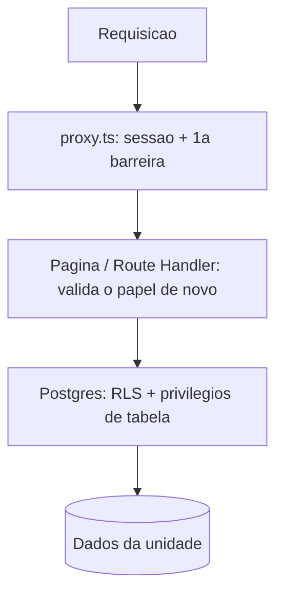

# Matriz de permissões e RLS

O isolamento entre unidades é feito **no banco** (RLS). Se a aplicação tiver um bug, o Postgres ainda barra o acesso indevido. A `service_role` ignora a RLS e só é usada no servidor.

## Quem pode o quê

Legenda: **R** ler · **C** criar · **U** atualizar · **D** apagar · **—** nada

| Tabela | Anônimo | Sem papel | Barbeiro | Recepção | Admin da rede |
|---|---|---|---|---|---|
| `units` | — | — | R (só a sua) | R (só a sua) | R, C, U (todas) |
| `profiles` | — | R, U\* (o próprio) | R, U\* (o próprio) | R (o próprio e quem é da sua unidade), U\* (o próprio) | R (todos), U\* (o próprio) |
| `unit_members` | — | R (o próprio) | R (o próprio) | R (os da sua unidade) | R, C, U, D (todos) |

\* `profiles`: o usuário só altera `full_name` e `phone`. `email` e `is_active` não são editáveis por ele (privilégio de coluna). `is_active` muda só pelo servidor.

Observações:

- "A sua unidade" só vale enquanto **vínculo, perfil e unidade estão ativos** e a unidade não foi excluída. Desativar uma unidade tira o acesso da recepção e dos barbeiros dela imediatamente.
- Recepção **não** altera a própria unidade; só o admin da rede.
- Criar usuários e vínculos é função do admin da rede (e, em fase futura, da recepção para barbeiros da própria unidade). Na prática, convites passam pelo servidor com `service_role`, **depois** de validar o papel de quem pediu.

## Defesa em camadas

1. **Privilégios de tabela**: `anon` não tem acesso algum às tabelas; `authenticated` só o necessário.
2. **RLS** ligada em todas as tabelas, com policies por papel e unidade.
3. **Funções** de autorização `SECURITY DEFINER` (sem recursão de policy, sem acesso por anônimos).
4. **Aplicação**: valida o papel no servidor antes de renderizar ou executar ações.

## Como testamos

| Teste | O que cobre | Precisa de |
|---|---|---|
| `npm run test:rls:offline` | Roda as migrations num Postgres embutido (PGlite) e confere 27 cenários: anônimo, recepção A e B, barbeiro, sem papel, admin, unidade desativada, escalada de privilégio, `is_active` | Nada (offline) |
| `npm run test:rls` | Os mesmos cenários **no Supabase real**, com usuários temporários logados via anon key. Limpa tudo no fim | Migrations aplicadas + `.env.local` |
