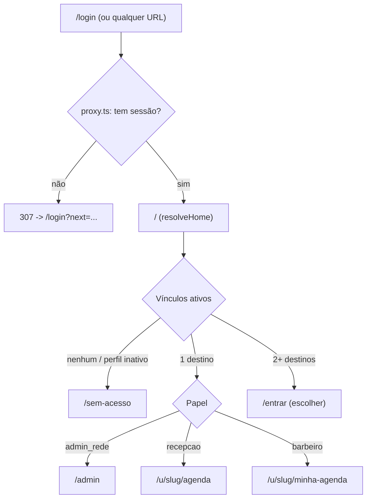
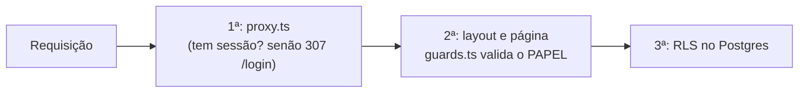

# Redirecionamento e autorização por papel

Depois do login, cada usuário é levado para a sua área, e **cada área valida o papel de novo**. Tudo é decidido **no servidor**; o navegador nunca é a única barreira.

## Para onde cada papel vai



| Situação | Destino |
|---|---|
| `admin_rede` | `/admin` |
| `recepcao` de uma unidade | `/u/<slug>/agenda` |
| `barbeiro` de uma unidade | `/u/<slug>/minha-agenda` |
| Mais de um papel ou unidade | `/entrar` (tela para escolher) |
| Sem vínculo, vínculo inativo, perfil inativo ou unidade desativada | `/sem-acesso` |
| Sem sessão | `/login?next=<rota>` |

## Quem entra onde

| Rota | admin_rede | recepcao (da unidade) | barbeiro (da unidade) | Outra unidade | Sem papel |
|---|---|---|---|---|---|
| `/admin` | ✅ | ❌ | ❌ | ❌ | ❌ |
| `/u/<slug>/agenda` | ✅ | ✅ | ❌ | ❌ | ❌ |
| `/u/<slug>/minha-agenda` | ✅ | ❌ | ✅ | ❌ | ❌ |

Todo acesso indevido vai para **`/sem-acesso?motivo=area`**, inclusive quando a unidade nem existe. Assim não se revela quais unidades existem.

> **Decisão a validar:** o administrador da rede pode abrir a área de qualquer unidade (é o dono da rede e já enxerga todas pela RLS). Se preferir que ele só use `/admin`, é uma linha em `canAccessUnitArea` (`src/lib/auth/roles.ts`).

## Duas barreiras, mais o banco



1. **`src/proxy.ts`**: renova a sessão e devolve **307 para `/login`** quando não há sessão numa rota protegida. Não decide papéis.
2. **`src/lib/auth/guards.ts`**: `requireAuth`, `requireNetworkAdmin`, `requireUnit`, `requireUnitArea`. Chamados no **layout e na própria página**. Layouts não rodam de novo em navegação entre páginas, então a página precisa validar também.
3. **RLS**: mesmo se uma tela esquecer o guard, o banco só entrega dados da unidade do usuário (ver [permissoes-rls.md](permissoes-rls.md)).

Páginas protegidas usam `export const instant = false` (Next 16): bloqueiam no servidor e respondem com **redirecionamento HTTP de verdade**, sem renderizar conteúdo antes.

## Código

| Arquivo | Papel |
|---|---|
| `src/lib/auth/roles.ts` | Regras **puras**: destinos, `resolveHome`, `canAccessUnitArea` (testadas com Vitest) |
| `src/lib/auth/session.ts` | `getAuthContext()`: usuário + vínculos lidos **sob a RLS**; ignora vínculo sem unidade ativa |
| `src/lib/auth/guards.ts` | Guardas que redirecionam |
| `src/components/app-shell.tsx` | Moldura: marca, papel, unidade, e-mail e **Sair** |
| `src/app/page.tsx` | `/` decide o destino |
| `src/app/entrar/page.tsx` | Escolha de área |
| `src/app/sem-acesso/page.tsx` | Mensagem genérica de acesso negado |
| `src/app/admin/*`, `src/app/u/[slug]/*` | Áreas protegidas (conteúdo entra nas próximas fases) |

## Como testar

Automático (precisa do app rodando em `npm run dev`):

```bash
npm test             # regras puras (Vitest)
npm run test:access  # 41 verificações com usuários reais e HTTP real
```

`test:access` cria usuários e uma unidade temporários, faz login de verdade e confere status HTTP e destino em cada rota: sem login, admin, recepção A, barbeiro A, recepção B (outra unidade), sem papel, usuário com vários papéis, **unidade desativada** e **perfil desativado**. Exige redirecionamento 3xx real, não apenas um `meta refresh`. Limpa tudo no final.

Manual: entre com os usuários de `.dev-credentials.local.md` (gerado por `npm run db:seed`):

| Usuário | Deve cair em |
|---|---|
| `admin.teste@donguillermo.dev` | `/admin` |
| `recepcao.teste@donguillermo.dev` | `/u/sao-bernardo-metropole/agenda` |
| `barbeiro.teste@donguillermo.dev` | `/u/sao-bernardo-metropole/minha-agenda` |

E, logado como recepção, digite `/admin` na URL: deve aparecer "Sem acesso".
